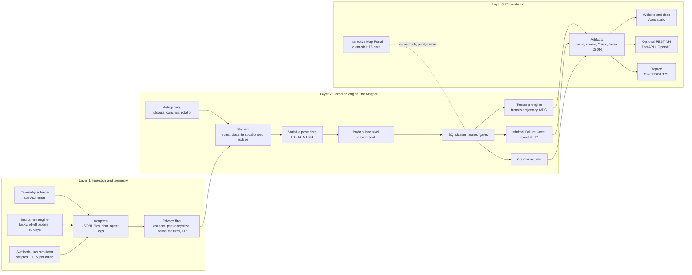

# Architecture

Three layers (ingestion, compute, presentation) in one monorepo. The design goal is a **small, auditable core** whose math is specified once and implemented twice, surrounded by thin, replaceable adapters.

## 1. Principles

1. **One source of truth per concern.** Math: `spec/SPEC.md` + `spec/config/`. Data shapes: `spec/schemas/`. Everything else is generated or verified against these.
2. **Pure core, impure edges.** Scoring, assignment, gating, zoning, cover, and counterfactuals are pure, deterministic functions. I/O, network, and model calls live in adapters.
3. **Two implementations, one truth.** Python is the reference. TypeScript re-implements only what the browser needs. Shared golden vectors prove parity.
4. **Static first.** The public site and portal are static files deployable on GitHub Pages. Maps and Cards are build-time artifacts. The optional API is a thin wrapper around the same Python functions.
5. **Files before servers.** v0.1 uses Parquet/JSONL and SQLite. No database server, queue, or orchestrator.
6. **Provenance everywhere.** Every artifact embeds `spec_version`, `config_hash`, `git_sha`, `lock_hash`, seeds, and a signature.

## 2. System overview



## 3. Repository packages

| Package | Path | Language | Responsibility |
| --- | --- | --- | --- |
| `symnoesis` | `packages/py` | Python 3.12+ | Reference implementation, CLI, optional API |
| `@symnoesis/core` | `packages/ts` | TypeScript | Browser-side subset: Gray grid, assignment, net effects, SQ, classes, zones, neighbors, portal projection |
| `web` | `apps/web` | Astro + Svelte | Website, docs rendering, research log pages, Map explorer, Portal |
| `spec` | `spec/` | YAML/JSON/MD | Specification, config, schemas, vectors, instruments, domains |

Dependency rule: `web → @symnoesis/core → spec`; `symnoesis → spec`. `web` never imports Python. `@symnoesis/core` never imports `web`. Cycles are forbidden (enforced by `dependency-cruiser` and `import-linter`).

## 4. Python package (`packages/py/src/symnoesis/`)

```
config.py         load + validate YAML, compute config hash
gray.py           gray(), inverse_gray(), neighbors(), hamming()
grid.py           pixel ids <-> (col,row) <-> bits; resolution coarsening
variables.py      VariableScore (mu, sigma, theta), effect-to-score mapping
assign.py         probabilistic pixel assignment (SPEC §3)
net_effects.py    HNE, SNE (SPEC §5)
stability.py      S, S_eff (SPEC §6)
gates.py          CHI registry, ceilings, gate status
sq.py             SQ per dyad-window and per pixel, cluster bootstrap CI
classes.py        symbiosis classes
zones.py          zone precedence + secondary tags
temporal.py       frames, ΔSQ, MDC, trajectory
cover.py          Minimal Failure Cover (MILP + strict mode)
counterfactual.py single-flip diagnostics, additive pooled model
evidence.py       evidence tier logic
records.py        pydantic models generated from spec/schemas
telemetry/        adapters, consent, pseudonymize, features, dp
modules/          cog/, epi/, aff/, saf/, mch/, rec/  (each: tasks, scorers, README)
judges/           judge interface, calibration harness, Krippendorff α
simulator/        personas, scripted dynamics, LLM-driven persona adapter
providers/        Provider protocol + adapters (OpenAI-compatible, Anthropic, local) as optional extras
reports/          Symnoesis Card (JSON, HTML, PDF), Index builder
signing.py        Ed25519 signing and verification of manifests
api/              FastAPI app (optional extra)
cli.py            typer CLI
```

CLI (stable surface): `symnoesis validate | map | cover | card | sweep | judge-calibrate | index | spec-check | repro | vectors`.

## 5. TypeScript package (`packages/ts/src/`)

`gray.ts`, `grid.ts`, `erf.ts` (Cody erfc), `assign.ts`, `netEffects.ts`, `sq.ts`, `classes.ts`, `zones.ts`, `neighbors.ts`, `projection.ts` (portal), `types.generated.ts` (from schemas), `config.generated.ts` (from YAML at build time). No runtime dependencies except zod.

## 6. Data and storage

| Data | Format | Location | Notes |
| --- | --- | --- | --- |
| Raw telemetry (opt-in, real) | Never in repo | Operator-controlled encrypted store | Derived features only retained |
| Derived features | Parquet | Operator store; synthetic fixtures in `data/fixtures/` | Schema in `spec/schemas/` |
| Run manifests | JSON, signed | `data/releases/<run_id>/manifest.json` | Hash chain |
| Maps, covers, Cards | JSON | `data/releases/<run_id>/` → copied to `apps/web/public/data/` at build | Zod-validated at site build |
| Private holdout items | Encrypted | Never in repo | Access-logged |
| Research log, ADRs, build log | Markdown | `research/`, `docs/adr/`, `docs/build-log/` | Append-only by convention |

## 7. Site and portal data flow

1. CI runs the reference synthetic sweep → artifacts with hashes.
2. Astro build validates every artifact with zod; a failed validation fails the build.
3. Map explorer and Index pages render only validated artifacts, always with the evidence tier.
4. The Portal loads `@symnoesis/core` and `portal-model.v0.1.json` (item→variable weights, tier E0) and computes entirely in the browser. No `fetch` to third parties; no storage by default.

## 7a. Portal projection model (E0)

Answers to 12–16 questionnaire items map to `(μ_i, σ_i)` for `H1–H4` through a transparent linear model with documented, expert-elicited weights (file `spec/portal/portal-model.v0.1.json`), clearly labeled **uncalibrated**. Machine-side bits come from a user choice: a published Card (when available) or an archetype (`agreeable-engagement-tuned`, `candid-and-bounded`, `unknown`), which sets `(μ, σ)` for `M1–M4` with wide σ. Output: modal pixel, pixel-mass distribution, zone probabilities, top single-flip changes. Nothing is a measurement of the user; it is the framework applied to self-reported habits.

## 8. Optional REST API (OpenAPI 3.1, FastAPI)

| Method | Path | Purpose |
| --- | --- | --- |
| GET | `/healthz` | Liveness |
| GET | `/v1/spec` | Spec version, config, hash |
| POST | `/v1/runs` | Submit a signed run (derived features + manifest) |
| GET | `/v1/runs/{id}` | Run status and manifest |
| GET | `/v1/systems/{system}/versions/{version}/maps/{frame}` | Map for a frame |
| GET | `/v1/…/pixels/{pixel_id}` | Pixel record |
| GET | `/v1/cards/{system}/{version}` | Symnoesis Card |
| POST | `/v1/project` | Stateless portal-equivalent projection (for integrations) |

REST only. GraphQL and WebSocket subscriptions are out of scope for v0.1 (ADR-0007). The API is not required for the public site and is shipped as a Docker image with a read-only default.

## 9. Security and integrity

- Signed manifests (Ed25519); verification in CI and in `symnoesis repro`.
- Supply chain: lockfiles, pinned Action SHAs, Dependabot, `pip-audit`, `npm audit`, SBOM (CycloneDX) per release, OpenSSF Scorecard, `gitleaks`, CodeQL.
- Site: self-hosted fonts, no third-party requests, CSP meta tag, `rel="noopener"` on external links, no cookies.
- API: input validation via pydantic, request-size limits, no raw text accepted, rate limiting, per-key authorization.

## 10. Deployment

- **Site:** GitHub Actions builds Astro with `SITE_URL` and `BASE_PATH` from repository variables, deploys with the official Pages action. Custom domain optional.
- **Python:** published to PyPI via trusted publishing on tagged releases (maintainers decide when).
- **TS:** published to npm on tagged releases (same rule).
- **Archive:** each tagged release is archived on Zenodo (via the GitHub integration) with `CITATION.cff`.
- **Docker:** `docker/api.Dockerfile` for the optional API; non-root, minimal image.

## 11. Extensibility points

New instruments register in `modules/<m>/` with a YAML definition and scorer; new domains add `spec/domains/<name>.yaml`; new providers implement `Provider`. Spec changes require an RFC. None of these may change core math without a spec version bump.
